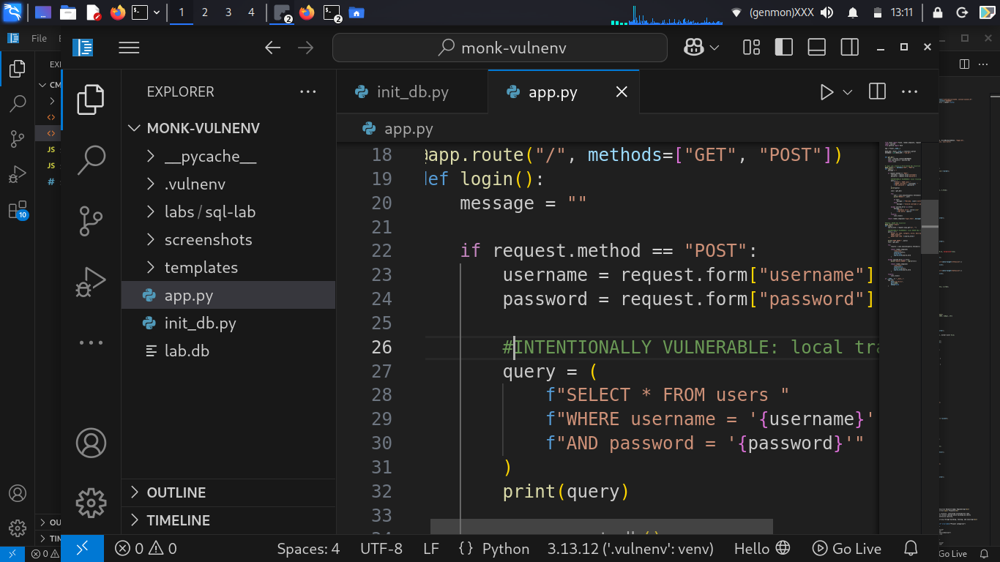
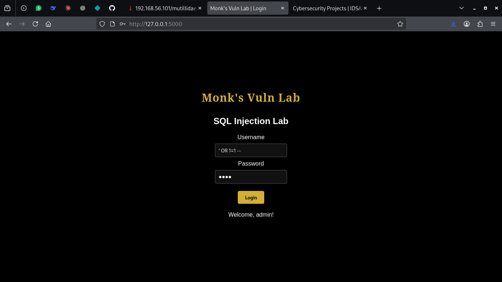
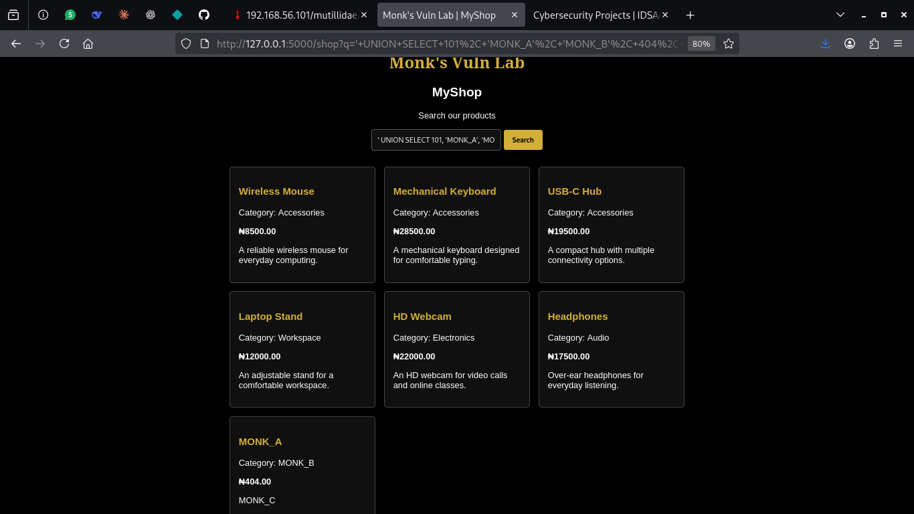
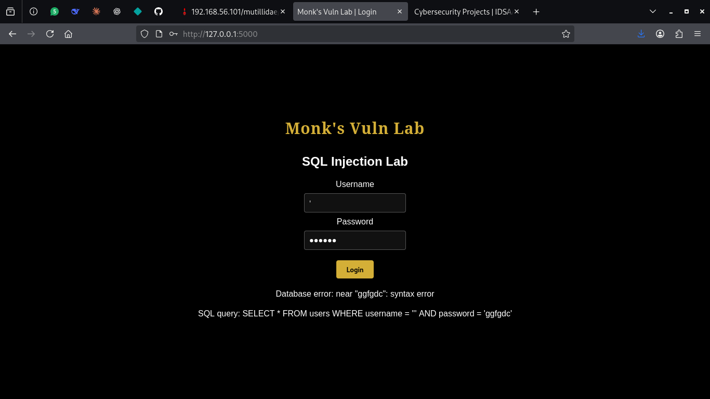
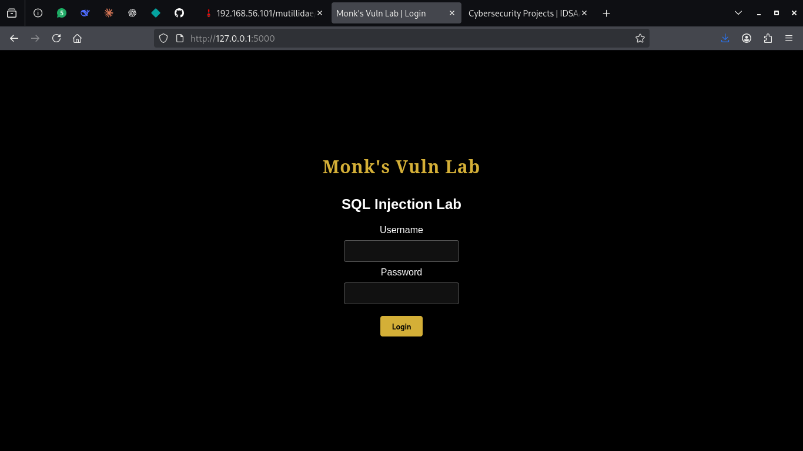
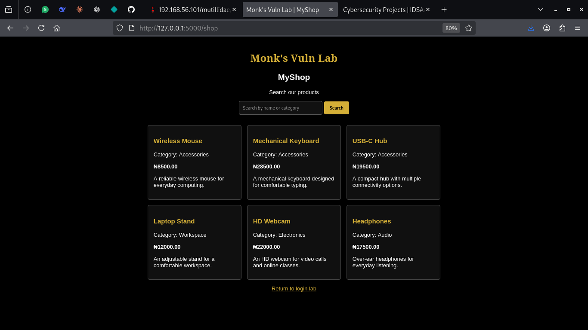
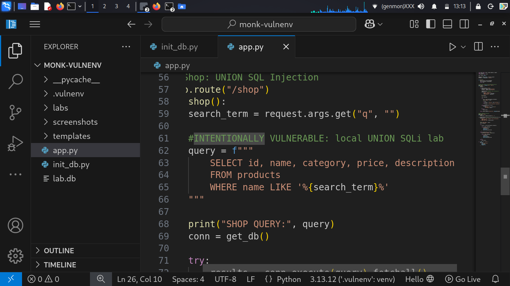

# SQL Injection Lab: Flask & SQLite

A hands-on cybersecurity lab built to investigate SQL injection vulnerabilities in a deliberately vulnerable Flask web application backed by SQLite.

The project explores how unsafe SQL query construction can affect authentication, expose database errors, and allow unauthorized manipulation of query results. All testing was performed in a local, controlled lab environment.

> **Disclaimer:** This project is for educational purposes and authorized security testing only. The application is intentionally vulnerable and must not be exposed to the public internet.

## Table of Contents

- [Project Overview](#project-overview)
- [Objectives](#objectives)
- [Technologies](#technologies)
- [Lab Architecture](#lab-architecture)
- [Setup and Installation](#setup-and-installation)
- [Vulnerability Testing and Findings](#vulnerability-testing-and-findings)
- [Evidence Gallery](#evidence-gallery)
- [Remediation Recommendations](#remediation-recommendations)
- [Limitations](#limitations)
- [Key Lessons](#key-lessons)
- [Future Improvements](#future-improvements)

## Project Overview

The lab consists of a local web application with a product search feature and a login form. Both features were designed to demonstrate the security risks associated with inserting user-controlled input directly into SQL statements.

The application uses Python and Flask for its web functionality and SQLite for data storage.

Testing focused on identifying vulnerable query construction, observing the resulting application behavior, and understanding how parameterized queries and safer error handling can reduce risk.

## Objectives

- Understand the root cause of SQL injection.
- Investigate authentication bypass in a deliberately vulnerable login form.
- Demonstrate UNION-based SQL injection against a product search query.
- Observe how database errors can disclose technical information.
- Distinguish confirmed findings from inconclusive or untested techniques.
- Identify practical remediation measures.

## Technologies

- Python
- Flask
- SQLite
- SQL
- HTML and CSS
- Linux

## Lab Architecture

The application runs locally and uses an SQLite database containing product and user records.

```text
Browser
   |
   v
Flask Web Application
   |
   +---- Login Route --------> Users Table
   |
   +---- Product Search -----> Products Table
   |
   v
SQLite Database
```

### Repository Structure

```text
monk_vulnsql/
├── app.py
├── init_db.py
├── requirements.txt
├── README.md
├── .gitignore
├── templates/
│   ├── login.html
│   └── shop.html
└── screenshots/
    ├── 01-lab-homepage.png
    ├── 02-lab-homepage.png
    ├── 03-vulnerable-login-query.png
    ├── 04-authentication-bypass.png
    ├── 05-vulnerable-search-query.png
    ├── 06-union-injection-results.png
    └── 07-database-error-disclosure.png
```

The screenshot filenames above reflect the files currently reported in the local screenshots directory.

The local database and virtual environment should not be committed if they contain unnecessary local data or environment-specific files. Use the initialization script to recreate the lab database.

## Setup and Installation

### Prerequisites

- Python 3
- pip
- A terminal

### 1. Clone the repository

```bash
git clone https://github.com/IDSAAT/monk_vulnsql.git
cd monk_vulnsql
```

Update the repository URL if the project is published under a different repository name.

### 2. Create and activate a virtual environment

```bash
python3 -m venv .vulnenv
source .vulnenv/bin/activate
```

### 3. Install dependencies

```bash
pip install -r requirements.txt
```

### 4. Initialize the database

```bash
python init_db.py
```

### 5. Run the application locally

```bash
python app.py
```

Open the local address configured by the application, normally:

`http://127.0.0.1:5000`

Keep the application bound to localhost. Do not expose this intentionally vulnerable application to an external network.

## Vulnerability Testing and Findings

### 1. SQL Injection in the Login Form

**Status: Confirmed in the local lab**

The login route constructed its SQL query by inserting the submitted username and password directly into the query string.

The vulnerable query followed this pattern:

```python
query = (
    f"SELECT * FROM users "
    f"WHERE username = '{username}' "
    f"AND password = '{password}'"
)
```

Because the input was not parameterized, specially crafted input could change the intended SQL logic.

**Test input:**

```sql
' OR 1=1 --
```

**Observed result:**

The application accepted the crafted input and displayed a welcome message for the administrator account. The query returned a matching record, and the application used `fetchone()` to retrieve the first matching row.

**Security impact:**

An attacker may bypass the intended authentication check without supplying valid credentials.

**Evidence screenshots:**





### 2. UNION-Based SQL Injection in Product Search

**Status: Confirmed in the local lab**

The product search route inserted the supplied search term directly into a SQL `LIKE` expression.

The vulnerable query followed this pattern:

```python
query = f"""
    SELECT id, name, category, price, description
    FROM products
    WHERE name LIKE '%{search_term}%'
"""
```

The original query returned five columns. A UNION-based test demonstrated why the number and compatible types of returned columns matter when combining query results.

A six-column test produced a column-count mismatch error. A five-column test executed successfully.

A marker-based test used the following input:

```sql
' UNION SELECT 101, 'MONK_A', 'MONK_B', 404, 'MONK_C' --
```

**Observed result:**

The marker values appeared in the rendered product results:

- `MONK_A` appeared as the product name.
- `MONK_B` appeared as the category.
- `404` appeared as the price.
- `MONK_C` appeared as the description.

The identifier column was selected by the query but was not rendered in the product card.

A further read-only test using a UNION with the existing products query returned product records successfully.

**Security impact:**

Unsafe query construction can allow a user to alter the query's result set and potentially access data beyond the intended search results, depending on database permissions and application behavior.

**Evidence screenshot:**



### 3. Database Error Disclosure

**Status: Confirmed in the local lab**

Malformed SQL input caused SQLite to return a syntax error. The application displayed database error details during testing.

The product template was also updated to handle `NULL` price values without causing a formatting failure, displaying `N/A` when the price was absent. This made it possible to observe UNION query results containing `NULL` values.

**Security impact:**

Detailed database errors can reveal implementation details and help an attacker refine further input. Exposing raw errors to users is unnecessary and can increase the risk of exploitation.

**Evidence screenshot:**



### 4. Boolean-Based Blind SQL Injection

**Status: Inconclusive at the web-application level**

Basic true and false expressions were verified directly in SQLite. However, the corresponding web-application tests did not produce sufficiently clear, reproducible evidence to confirm Boolean-based blind SQL injection through the application's response behavior.

This technique is therefore recorded as inconclusive rather than a confirmed vulnerability.

### 5. Time-Based Blind SQL Injection

**Status: Not tested**

Time-based blind SQL injection was discussed as a technique, but no successful application-level test was performed. No claim of a time-based vulnerability is made.

## Evidence Gallery

The following screenshots document the lab setup and confirmed observations. Images are stored in the repository's `screenshots/` directory and referenced using relative Markdown paths.

### 1. Lab Homepage



Shows the local application interface. The screenshot should display the product search page or another clearly identifiable lab landing view.

### 2. Additional Lab View



This image is included under its current filename. Its exact evidence description should be updated after checking what the screenshot shows.

### 3. Vulnerable Login Query


Shows the unsafe SQL construction used by the login route.

### 4. Authentication Bypass


Shows the observed login bypass result in the local application.

### 5. Vulnerable Product Search Query



Shows the unsafe SQL construction used by the product search route.

### 6. UNION-Based Injection Results


Shows the marker values returned by the UNION-based test.

### 7. Database Error Disclosure


Shows the database error exposed by the application during malformed-input testing.

> **Evidence integrity:** Screenshot filenames and descriptions should match the actual image contents. Only use screenshots that show genuine results from the local lab.

## Remediation Recommendations

The following measures are recommended. They are remediation proposals and should not be considered implemented or verified until the code has been updated and retested.

### 1. Use Parameterized Queries

Replace dynamically constructed SQL with parameterized statements.

For the product search:

```python
query = "SELECT id, name, category, price, description FROM products WHERE name LIKE ?"
results = conn.execute(query, (f"%{search_term}%",)).fetchall()
```

This keeps the supplied search term separate from the SQL statement.

### 2. Improve Authentication

- Retrieve the account using a parameterized username query.
- Store passwords using a suitable password-hashing algorithm.
- Verify submitted passwords against their stored hashes.
- Avoid storing or comparing plaintext passwords in production.
- Return generic authentication failure messages.

### 3. Handle Errors Safely

- Show users a generic error message.
- Keep detailed database diagnostics in protected server-side logs.
- Avoid exposing raw SQL queries or internal exception details in responses.

### 4. Apply Least Privilege

Give the application's database connection only the permissions required for its intended functions. Avoid unnecessary access to sensitive data and administrative operations.

### 5. Add Regression Tests

After remediation, test normal product searches, login success, login failure, malformed inputs, and previously successful injection attempts. Confirm that input is handled as data rather than executable SQL.

## Limitations

- The lab was tested locally, not against a production application.
- The successful findings apply to this deliberately vulnerable implementation.
- Boolean-based blind SQL injection was not conclusively demonstrated through the web application.
- Time-based blind SQL injection was not tested.
- The remediation examples have not been claimed as implemented or retested.

## Key Lessons

This project reinforced several important lessons:

- User input must not be concatenated directly into SQL statements.
- Authentication logic can fail when user-controlled input changes SQL syntax.
- UNION-based injection depends on compatible result structures.
- Error messages can disclose useful implementation details.
- Security reporting should distinguish observed evidence from assumptions.
- A vulnerability is not considered remediated until the fix has been tested.

## Future Improvements

- Implement and verify parameterized queries.
- Improve password storage and authentication logic.
- Add automated regression tests.
- Capture before-and-after evidence of remediation.
- Expand the lab with additional SQL injection scenarios where appropriate.

**Author:** IDU SAMUEL 
**Focus:** Cybersecurity · Web Application Security · Secure Coding

**GitHub:** [github.com/IDSAAT](https://github.com/IDSAAT)
